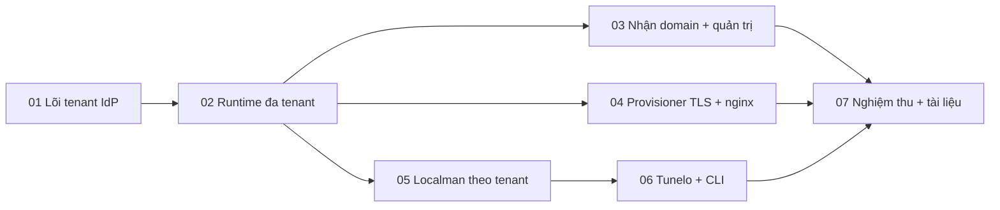

# Mọi app chạy theo domain

## Overview

Hôm nay mỗi app gắn cứng với `hoandat.com`: một issuer, một bộ resource/audience, một OAuth app Google/GitHub, một bot, chữ "hoandat" trong giao diện. Plan này biến IdP `hoandat-auth`, Localman và Tunelo (repo `localman-next`) thành dịch vụ đa tenant theo domain. Chủ domain bắt đầu ở `https://auth.hoandat.com/claim`, chứng minh sở hữu bằng TXT, tự khai OAuth Google/GitHub và token DNS Cloudflare, rồi có `auth.<domain>`, `localman.<domain>`, `*.localman.<domain>`, `tunnel.<domain>`, `*.tunnel.<domain>` với tài khoản và dữ liệu cô lập. `hoandat.com` thành tenant số 1, giữ nguyên issuer, `kid`, client và dữ liệu.

Hợp đồng (outcome, constraints, non-goals, acceptance) và mọi quyết định của user/Jev: [`../reports/brainstorm-261013-0727-multi-tenant-auth-by-domain.md`](../reports/brainstorm-261013-0727-multi-tenant-auth-by-domain.md). Plan dùng lại nguyên các trường đó.

## Quyết định khi lập plan và red-team (2026-10-13)

| Câu hỏi | Chọn | Ai quyết |
|---|---|---|
| Cô lập dữ liệu | Trường `tenantId` trên mọi collection của cả ba app, chỉ mục ghép, repository bắt buộc tenant | Jev 0.97 |
| Telegram, Turnstile, Web Push, owner Localman | Tuỳ chọn theo tenant; chưa khai thì tắt | Jev 0.80 |
| Ai chạy certbot | Provisioner root riêng; IdP không chạy lệnh hệ thống | Jev 0.64 |
| Thứ tự | Lõi IdP trước, rồi runtime, nhận domain, provisioner, Localman, Tunelo, nghiệm thu | Jev 1.00 |
| Trần tenant | Một trần `TENANT_MAX_ACTIVE`, không loại khỏi cache (red-team RT 13); giá trị mặc định chốt sau khi đo RSS ở phase 02. Jev nghiêng "không trần" (0.57, độ tin 0.35) nhưng acceptance 8 của hợp đồng yêu cầu trần | user (hợp đồng) |
| Nơi bắt đầu nhận domain | HTTPS trên `auth.hoandat.com/claim`, người nhận đăng nhập trước, TXT gắn danh tính, owner là danh tính đó; sau khi nhận mọi thứ chạy trên domain của tenant | user, Jev 1.00 |
| `tunnel.inetdev.io.vn` | Gỡ hẳn trước phase 06, không có alias | user, Jev 0.73 |
| Lùi sau khi có tenant thứ hai | Chỉ sửa tiến hoặc tạm đình chỉ tenant mới; đọc tương thích gỡ trước khi tạo tenant thứ hai | user, Jev 1.00 |

## Phases

| # | Phase | Repo | Tier | Phụ thuộc | Trạng thái |
|---|---|---|---|---|---|
| 01 | [IdP: lõi tenant, hoandat là tenant duy nhất](./phase-01-idp-tenant-core.md) | hoandat-auth | L | — | done |
| 02 | [IdP: runtime đa tenant, sổ tenant, secret, trần](./phase-02-idp-multi-tenant-runtime.md) | hoandat-auth | L | 01 | done |
| 03 | [Nhận domain và trang quản trị tenant](./phase-03-claim-and-tenant-admin.md) | hoandat-auth | L | 02 | done |
| 04 | [Provisioner TLS và nginx](./phase-04-provisioner-tls-nginx.md) | hoandat-auth (`infra/`) + server block của từng app | L | 02 | done |
| 05 | [Localman theo tenant](./phase-05-localman-per-tenant.md) | localman-next | XL | 02 | done |
| 06 | [Tunelo và CLI theo tenant](./phase-06-tunelo-per-tenant.md) | localman-next | L | 02, 05; gỡ `tunnel.inetdev.io.vn` trước | done |
| 07 | [Nghiệm thu đầu-cuối và tài liệu](./phase-07-cutover-and-acceptance.md) | cả hai | M | 03, 04, 05, 06 | done |

Cổng giữa phase 02 và mọi phase tạo tenant thứ hai: backfill báo 0 bản ghi thiếu `tenantId`, đọc tương thích và 5 chỉ mục unique cũ đã gỡ (RT 4).

## Kiến trúc đích

- **Tenant** = một domain gốc đã nhận. Issuer `https://auth.<domain>`; Localman `https://localman.<domain>`, mock `*.localman.<domain>`; Tunelo `https://tunnel.<domain>`, tunnel `*.tunnel.<domain>`. Resource/audience suy từ domain (`resourcesFor(tenant)`); client id cố định cho mọi tenant.
- **IdP**: một process; sổ tenant trong database `auth`; mỗi tenant hoạt động có một `TenantRuntime` (Provider, khoá ký, client, upstream Google/GitHub, Telegram tuỳ chọn, tên hiển thị) dựng lười, single-flight, không loại khỏi cache, tenant cũ ghim; rate limit một store toàn process khoá `(tenantId, IP)`. Mọi dữ liệu mang `tenantId`.
- **API nội bộ**: listener loopback riêng, không qua nginx, Basic credentials theo app; cấp tra tenant, JWKS/metadata của tenant, hàng đợi chứng chỉ. Không có API trả secret.
- **Secret**: mã hoá theo lớp; token DNS niêm phong cho provisioner; secret client app suy bằng HMAC theo tenant.
- **Localman, Tunelo**: một process mỗi app; tenant `hoandat.com` dựng tĩnh từ env (không phụ thuộc IdP lúc chạy); tenant khác tra qua API nội bộ, stale-while-error; JWKS qua API nội bộ, không qua DNS công khai; mọi trạng thái (Mongo, map tunnel, cache Valkey, cổng TCP) theo tenant.
- **nginx**: mỗi app ship một server block regex theo quy ước; block cụ thể của `hoandat.com` giữ nguyên. **Provisioner** chỉ cấp chứng chỉ (HTTP-01, DNS-01 với credentials bền vững theo tenant); `certbot-renew.timer` gia hạn.
- **Sở hữu domain** được kiểm lại định kỳ; sai thì tenant `suspended`.

## Rủi ro chính

| Rủi ro | Giảm thiểu |
|---|---|
| Rò dữ liệu giữa tenant do quên `tenantId` | Repository bắt buộc tenant; test quét mã nguồn; test cô lập cho từng loại token, cookie, bản ghi và trạng thái trong bộ nhớ |
| Gián đoạn `hoandat.com` khi thêm `tenantId` | Ghi lọc theo `_id`, đọc/ghi tương thích có thời hạn; chỉ mục tạo trước deploy bằng script; backup trước |
| Chiếm tenant (đua log chứng chỉ, domain đổi chủ) | Nhận domain qua HTTPS gắn danh tính; JWKS qua API nội bộ; kiểm lại sở hữu định kỳ |
| Chèn cấu hình vào nginx/certbot chạy root | `normalizeTenantDomain` ở IdP và kiểm lại độc lập trong provisioner; `execFile` không shell; không sinh conf theo tenant |
| .65 hết RAM | Một trần active, single-flight; đo RSS ở phase 02; đường lùi chuyển máy riêng không đổi code |
| Giữ secret của tenant | Khoá theo lớp, AAD theo tenant, token DNS chỉ provisioner mở được; runbook backup/xoay khoá |
| nginx/certbot dùng chung | Block regex không chiếm host cụ thể; tài khoản ACME và config-dir riêng; backoff; staging khi thử; báo user trước khi đổi nginx |
| IdP sập kéo Localman/Tunelo | `hoandat.com` tĩnh từ env; stale-while-error cho tenant khác |

## Rollback

- Phase 01 và đầu phase 02 (chỉ có tenant cũ): lùi bằng deploy lại commit trước; trường `tenantId` và chỉ mục mới vô hại với code cũ. Lùi xong phải chạy lại backfill trước khi tiến tiếp.
- Sau cổng cuối phase 02 (đã gỡ tương thích, có thể có tenant thứ hai): **chỉ sửa tiến** hoặc tạm `suspended` các tenant mới; không deploy lại code chưa có tenant (code cũ tạo lại chỉ mục unique toàn cục và crash-loop, hoặc gửi audit sai tenant). Ghi trong ADR 0006.
- Phase 04: gỡ hàng đợi chứng chỉ và server block regex của app, `nginx -t`, reload. Phase 05–06: lùi release (`switch-release.sh`) trong giới hạn chính sách trên.

## Cổng kiểm mỗi phase

- `hoandat-auth`: `pnpm lint && pnpm typecheck && pnpm test && pnpm test:e2e && pnpm check:tokens`.
- `localman-next`: `pnpm lint && pnpm typecheck && pnpm test && pnpm check:mcp-coverage && pnpm e2e`.
- Deploy prod chỉ khi user yêu cầu cho chính lần đó; theo skill `hoandat-auth-ops-prod` / `localman-ops-prod` (backup trước, đếm restart trước và sau 15 phút).

## Red Team Review

### Session — 2026-10-13

**Findings:** 15 sau khi gộp từ 41 phát hiện của 4 reviewer (15 nhận, 1 bác). **Mức:** 8 Critical, 7 High. Mọi phát hiện có trích dẫn `file:dòng`. User chọn "áp dụng cả 15".

| # | Finding | Mức | Disposition | Áp vào |
|---|---|---|---|---|
| RT 1 | Resource/audience, đích token exchange, DCR, client id cứng theo hoandat | Critical | Accept | Phase 01, 02 |
| RT 2 | Ghi của adapter lọc `tenantId` vỡ phiên/refresh khi chưa backfill; `_id` toàn cục | Critical | Accept | Phase 01 |
| RT 3 | Ba chỉ mục unique toàn cục bị sót; `conflictField` | Critical | Accept | Phase 01, 02 |
| RT 4 | Rollback sau tenant thứ hai crash-loop/rò audit; đọc tương thích quá dài | Critical | Accept | Phase 01, 02, plan Rollback |
| RT 5 | Chiếm owner qua đua log chứng chỉ; trang nhận HTTP chết với HSTS | Critical | Accept (user chọn claim trên `auth.hoandat.com`) | Phase 03, hợp đồng |
| RT 6 | JWKS qua DNS công khai của tenant, không kiểm lại sở hữu | Critical | Accept | Phase 02, 05, 06 |
| RT 7 | API nội bộ lộ public, một khoá cho mọi secret, audit thiếu credential | Critical | Accept | Phase 02, 03, 04 |
| RT 8 | Tunelo khoá theo subdomain trần (map, Valkey, TCP) | Critical | Accept | Phase 06 |
| RT 9 | `tunnel.inetdev.io.vn` trả 404, có thể bị nhận; trùng `server_name` | High | Accept (user chọn gỡ trước phase 06) | Phase 03, 04, 06 |
| RT 10 | Allowlist host của CLI, replay token | High | Accept | Phase 06 |
| RT 11 | Conf nginx theo tenant lệch CSP; xoá credentials hỏng gia hạn; ACME dùng chung; Cloudflare proxied | High | Accept | Phase 03, 04 |
| RT 12 | Domain từ Host vào nginx/certbot root, chèn cấu hình | High | Accept | Phase 01, 03, 04 |
| RT 13 | IdP trên đường nóng; cache runtime; rate limit reset; DoS claim | High | Accept | Phase 02, 03, 05, 06 |
| RT 14 | Kiểm kê Localman sai (43 model), SSRF, CORS, worker, `ownerSubs`; build chỉ mục trước listen | High | Accept | Phase 01, 05 |
| RT 15 | `domain` cookie trái `__Host-`; kiểm dạng `ISSUER` phá harness conformance | High | Accept | Phase 01, 02 |
| — | Thu hẹp `tenantId` chỉ cho collection không khoá theo `sub` | Medium | Reject: trái quyết định Jev đã chốt (0.97); cô lập đồng đều dễ kiểm hơn | — |

### Whole-Plan Consistency Sweep

- Đã thay ở mọi tệp: "17 model" → 43; "trang nhận domain HTTP trên domain của tenant" → khởi tạo trên `auth.hoandat.com/claim`; "provisioner sinh conf theo tenant" → server block regex của từng app; "LRU `TENANT_RUNTIME_CACHE_MAX`" → một trần `TENANT_MAX_ACTIVE`; "cookie theo tenant" → bỏ; "API trả secret client, owner xoay secret" → bỏ, secret suy HMAC; "gỡ đọc tương thích ở phase 07" → cuối phase 02 (IdP) và ngay sau backfill (Localman, Tunelo); "`<brand>-account`" → client id cố định.
- Hợp đồng brainstorm cập nhật cho thay đổi nơi bắt đầu nhận domain (Outcome, Quyết định, Acceptance 1).
- Không còn mâu thuẫn chưa giải quyết.

## Câu hỏi mở

- Giá trị trần mặc định (`TENANT_MAX_ACTIVE`, ngưỡng RAM chặn nhận domain): chốt sau khi đo RSS ở phase 02.
- Cơ chế chuyển owner từ `auth.hoandat.com/claim` sang `/admin` của tenant (đăng nhập lại bằng OAuth vừa khai hay phiên chuyển tiếp một lần): chốt khi làm phase 03, hỏi Jev.
