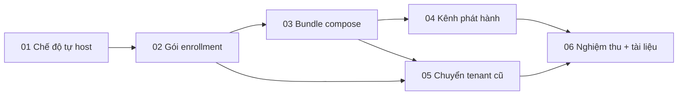

# Tenant tự host

> **Superseded 24/10/2026:** hệ sinh thái về đơn tenant ([ADR 0013](../../../docs/decisions/0013-single-tenant.md)); chế độ tự host, gói enrollment, chuyển tenant, bundle `deploy/self-hosted/` và workflow `selfhosted-release` đã gỡ. Plan này chỉ còn là lịch sử.

## Overview

Thêm chế độ "tự host" cho tenant (ADR [0007](../../../docs/decisions/0007-self-hosted-tenants.md)). Chủ domain nhận domain ở `https://auth.hoandat.com/claim` như ADR 0006, nhưng chỉ chứng minh sở hữu bằng TXT. hoandat cấp một gói enrollment ký, dùng một lần. Tenant chạy bundle compose (IdP, Localman, Tunelo, Chat) trên máy của họ với domain của họ là tenant chính, rồi đổi gói. Từ đó tenant ở trạng thái `self_hosted`: hoandat chỉ giữ bản ghi tối thiểu và kiểm TXT, không còn trên đường đi của request hay dữ liệu nào.

Đề xuất và mọi lựa chọn của Jev: [`../reports/architecture-261017-0723-self-hosted-tenant.md`](../reports/architecture-261017-0723-self-hosted-tenant.md).

## Outcome, ràng buộc, ngoài phạm vi, nghiệm thu

- **Outcome:** một tenant mới chọn tự host chạy được đăng nhập, Localman, Tunelo và Chat trên hạ tầng của mình mà không request nào đi qua hoandat; một tenant đang chạy trên hoandat chuyển được sang tự host mà không mất dữ liệu hay phiên.
- **Ràng buộc:** không đổi hành vi nào của tenant chạy trên hoandat và của `hoandat.com`; mọi quy tắc trong `CLAUDE.md` (tenant, secret, audit, ADR 0004, không email) giữ nguyên; không nhúng URL của `hoandat.com` vào code chạy (URL gateway là cấu hình).
- **Ngoài phạm vi:** chuyển ngược từ tự host về hoandat; hoandat vận hành, backup hay giám sát thay tenant; nhiều tenant trong một bản cài tự host; tự động cập nhật không cần operator đồng ý.
- **Nghiệm thu:**
  1. Nhận domain tự host chỉ cần TXT; không bao giờ kiểm bản ghi A, tạo runtime, chứng chỉ hay block nginx cho tenant đó trên hoandat (test).
  2. Gói enrollment chỉ đổi được một lần, trước khi hết hạn, khi TXT còn đúng và `https://auth.<d>` trả lời đúng thử thách của lượt đổi (test).
  3. Bản cài từ bundle compose chạy trên một máy sạch: đăng nhập Google/GitHub, Localman (web, MCP), Tunelo CLI và token exchange, Chat web/mobile/desktop; owner trong gói là người duy nhất mở được trang quản trị.
  4. Sau khi chuyển, sổ tenant trên hoandat chỉ còn domain, owner, trạng thái; không document nào của tenant còn trong `auth`, Localman, Chat trên .65 sau thời hạn giữ lại (đếm).
  5. Tenant chuyển từ hoandat giữ nguyên tài khoản, project, tin nhắn và khoá ký (`kid` không đổi); refresh token đã cấp vẫn dùng được sau khi đổi bản ghi A.
  6. `pnpm lint && pnpm typecheck && pnpm test && pnpm test:e2e && pnpm check:tokens` sạch ở hoandat-auth; cổng tương ứng sạch ở localman-next và chat-next.

## Giả định khi lập plan (user duyệt đề xuất 2026-10-17, chưa trả lời các câu hỏi mở)

| Câu hỏi | Giả định | Nguồn |
|---|---|---|
| Thứ tự tenant mới hay tenant cũ | Tenant mới trước (phase 01–04), export/import sau (phase 05) | đề xuất, báo cáo kiến trúc |
| Bundle gồm app nào | Cả bốn: IdP, Localman, Tunelo, Chat | đề xuất |
| Cập nhật | Kênh phát hành ký, operator kéo về | Jev 0,70 |
| Thời hạn giữ dữ liệu trên .65 sau khi chuyển | 14 ngày, bằng vòng xoay backup | đề xuất |

## Phases

| # | Phase | Repo | Tier | Phụ thuộc | Trạng thái |
|---|---|---|---|---|---|
| 01 | [Sổ tenant: chế độ tự host, nhận chỉ bằng TXT](./phase-01-self-hosted-claim.md) | hoandat-auth | L | — | done |
| 02 | [Gói enrollment và đổi gói](./phase-02-enrollment-bundle.md) | hoandat-auth | M | 01 | done |
| 03 | [Bundle compose bốn app](./phase-03-compose-bundle.md) | hoandat-auth, localman-next, chat-next | XL | 02 | done (nghiệm thu 19/10/2026, xem phase 06) |
| 04 | [Kênh phát hành có chữ ký](./phase-04-signed-release-channel.md) | cả ba | L | 03 | done |
| 05 | [Chuyển tenant đang chạy trên hoandat](./phase-05-migrate-existing-tenant.md) | cả ba | XL | 02, 03 | done (nghiệm thu 19/10/2026, xem phase 06) |
| 06 | [Nghiệm thu đầu-cuối và tài liệu](./phase-06-acceptance-and-docs.md) | cả ba | M | 04, 05 | done (nghiệm thu 19/10/2026, xem phase 06) |

Phase 01 và 02 deploy được lên production độc lập: trang claim chỉ hiện lựa chọn tự host khi bật cờ `SELF_HOSTED_CLAIMS` (mặc định tắt) cho tới khi phase 03 có bundle chạy được.

## Rủi ro chính

- Khoá ký rời .65 ở phase 05: truyền niêm phong, một lần, huỷ bản trên .65; sai bước thì tenant mất khoá hoặc khoá tồn tại ở hai nơi.
- Wildcard cần DNS-01 trên máy của tenant: bundle phụ thuộc token DNS do tenant giữ; zone không ở Cloudflare thì chưa hỗ trợ.
- Bundle và kênh phát hành là việc duy trì lâu dài; phiên bản của bốn app phải khớp nhau trong mỗi bản phát hành.

## Kết thúc (19/10/2026)

Nghiệm thu: diễn tập chuyển `inetdev.io.vn` (lab, rồi huỷ) và chuyển trọn `hoandat.io.vn` sang VM công khai 1 GB cài bằng `init.sh --release` (bản 0.3.1; bản sửa vào 0.3.2). Việc theo lịch: purge `hoandat.io.vn` trên .65 từ 02/11/2026 (`migrate/purge-tenant.sh`). Chưa thử trên domain thật: nhận mới ở chế độ tự host (đường TXT) — có test tích hợp và e2e.
