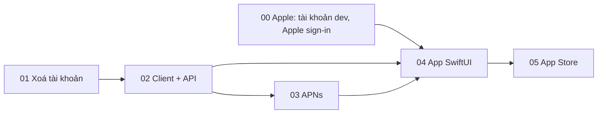

# App iOS Tài khoản

## Overview

User muốn đưa "app auth" lên App Store. Các trang web của IdP đã chạy tốt trên điện thoại (kiểm khổ iPhone SE ngày 20/10/2026, không tràn ngang). Nhưng một app chỉ bọc trang web sẽ bị loại theo guideline 4.2, và Google chặn đăng nhập trong WKWebView (`disallowed_useragent`). Vì vậy app là SwiftUI native: một OIDC public client mới, đăng nhập qua `ASWebAuthenticationSession`, mọi màn hình gọi một API JSON mới của IdP.

Apple bắt buộc xoá tài khoản ngay trong app (5.1.1(v)), trong khi IdP hiện chỉ ghi "liên hệ email" ở `/privacy`. Phase 01 thêm xoá tài khoản thật, dùng chung cho web và app, kèm ADR 0009.

Bằng chứng:
- Scout trong phiên (đường dẫn trích trong từng phase).
- Nghiên cứu App Store/OIDC/APNs: [`../reports/researcher-261020-0742-ios-account-app.md`](../reports/researcher-261020-0742-ios-account-app.md).
- Red team ba góc (bảo mật, lỗi khi chạy, giả định): [`../reports/red-team-261020-0742-ios-account-app.md`](../reports/red-team-261020-0742-ios-account-app.md).

## Outcome, ràng buộc, ngoài phạm vi, nghiệm thu

- **Outcome:** người dùng tenant chính tải app "Tài khoản" từ App Store, đăng nhập bằng Google, GitHub hoặc Apple. Trong app họ:
  - xem và sửa hồ sơ;
  - đăng xuất phiên và thiết bị, gỡ quyền ứng dụng;
  - liên kết và huỷ liên kết phương thức đăng nhập;
  - nhận thông báo đẩy khi có sự kiện bảo mật;
  - khoá app bằng Face ID;
  - xoá tài khoản.

  App phải qua review của Apple.
- **Ràng buộc:**
  - Mọi quy tắc của `CLAUDE.md` giữ nguyên: ADR 0004/0008 (chỉ Google/GitHub/Apple, không mật khẩu), tenant, audit ghi sau thao tác, không log token, tài khoản không bao giờ mất cách đăng nhập, `securityVersion`, không có đường auto-login.
  - Web `/account` giữ hành vi hiện có.
  - API không bao giờ yếu hơn web: thao tác `sensitive` trên web thì cần đăng nhập lại trên API.
  - Không thêm URL cố định của `hoandat.com` vào code chạy. Không gửi email.
- **Ngoài phạm vi:**
  - App Android; iPad tối ưu riêng; widget; Apple Watch.
  - Tenant sổ và tenant tự host (không có Apple sign-in, vướng 4.8). Cả xoá tài khoản cũng chỉ làm cho tenant chính.
  - Liên kết Telegram từ app (app chỉ hiển thị trạng thái).
  - Xoá dữ liệu của tài khoản trong Localman/Chat/Scribe (xem câu hỏi mở).
- **Nghiệm thu:**
  1. Xoá tài khoản từ web (CSRF + đăng nhập trong 10 phút + gõ lại username) và từ app (đăng nhập lại trong 10 phút) cho cùng kết quả, kiểm bằng test:
     - tài khoản bị khoá trước tiên;
     - Apple bị thu hồi;
     - phiên được đăng xuất kèm back-channel logout tới RP;
     - grant, token, interaction, thiết bị đẩy, claim bị xoá;
     - IP/UA của tài khoản trong `audit_outbox` bị xoá trắng;
     - document `accounts` bị xoá;
     - audit `account.deleted` được ghi.

     Đăng nhập lại cùng Google sau đó tạo tài khoản mới với `sub` mới.
  2. `/api/account` chỉ nhận access token opaque còn sống của `account-ios`, có scope `account`, grant đúng client và đúng tài khoản. Token của client khác, token đã thu hồi, token của tenant khác đều bị từ chối (test).
  3. Mỗi thao tác qua API dùng cùng service và cùng audit với route web, với guard tương đương: `write` ↔ bearer, `sensitive` ↔ bearer + đăng nhập lại (test cho cả hai phía).
  4. Thiết bị còn grant sống nhận thông báo đẩy cho danh sách sự kiện ở phase 03. Payload không chứa email, mã, token hay link (test duyệt mọi loại). Thiết bị đã đăng xuất, hết hạn hoặc bị thu hồi không nhận gì.
  5. App build bằng Xcode 26, chạy iOS 18 trở lên, chạy được trên máy thật với đủ các bước sau, rồi có trên TestFlight và được duyệt trên App Store:
     - đăng nhập bằng cả ba provider;
     - đi qua mọi màn hình;
     - Face ID;
     - nhận thông báo đẩy;
     - xoá tài khoản.
  6. Cổng CI xanh:
     - `pnpm lint && pnpm typecheck && pnpm test && pnpm test:e2e && pnpm check:tokens` trên CI;
     - job iOS (`xcodebuild test`) xanh;
     - test hợp đồng JSON chung giữa Node và Swift xanh.

## Quyết định

| Câu hỏi | Quyết định | Nguồn |
|---|---|---|
| Hướng app | SwiftUI native, API JSON, chỉ dùng trình duyệt hệ thống để đăng nhập | user 20/10/2026 |
| Xoá tài khoản | Xoá thật, ngay lập tức, có ADR 0009, dùng chung web và app | user 20/10/2026 |
| Apple Developer team | Team của Scribe, bundle id `com.hoandat.account` | user 20/10/2026 (cần xác nhận team đã được duyệt, xem phase 00) |
| Tenant | Chỉ tenant chính, cho cả app lẫn xoá tài khoản | 4.8, ADR 0008, red team |
| Xác thực API | Token opaque, kiểm như `loadSubject` của `token-exchange.ts:46-61` (`AccessToken.find`, grant đúng client và tài khoản, từ chối JWT) | scout, red team |
| Đăng nhập lại | Lượt authorize `prompt=login` với `require_auth_time`. App gửi `id_token` mới (`auth_time` ≤ 10 phút), chuyển sang grant mới và thu hồi grant cũ, để mỗi máy luôn chỉ có một dòng thiết bị | red team |
| Liên kết provider từ app | Purpose upstream mới `link-app`: state gắn tài khoản và `securityVersion`, hoàn tất không cần phiên IdP, không bao giờ tạo `oidc_session` | red team |
| Callback | Universal link `https://<issuer>/ios/callback`; AASA và entitlements có cả `applinks` lẫn `webcredentials`. Lùi về scheme riêng chỉ khi user đồng ý | nghiên cứu, red team |
| Refresh token | Gắn thiết bị, giữ trần 90 ngày | quyết định kỹ thuật |
| Thư viện | Không dùng AppAuth. APNs gọi `node:http2` + `jose`, không thêm dependency | nghiên cứu |
| Vị trí mã iOS | Thư mục `ios/` trong repo này, để API và app đổi trong cùng commit | quyết định kỹ thuật |
| iOS tối thiểu | 18.0 | nghiên cứu |

## Phases

| # | Phase | Tier | Phụ thuộc | Trạng thái |
|---|---|---|---|---|
| 00 | [Điều kiện tiên quyết ở Apple](./phase-00-apple-prerequisites.md) | S | — | pending (việc của user) |
| 01 | [ADR 0009 và xoá tài khoản (web)](./phase-01-account-deletion.md) | L | — | code xong, chờ CI và deploy |
| 02 | [Client `account-ios` và API `/api/account`](./phase-02-account-api.md) | L | 01 | pending |
| 03 | [Thông báo đẩy APNs](./phase-03-push-notifications.md) | M | 02 | pending |
| 04 | [App SwiftUI](./phase-04-ios-app.md) | XL | 00, 02, 03 | pending |
| 05 | [TestFlight, App Store và tài liệu](./phase-05-app-store-release.md) | M | 04 | pending |

Phase 01–03 làm song song được với phase 00. Mỗi phase deploy độc lập:
- Phase 01 có ích ngay cho web.
- Client `account-ios` chưa ai dùng cho tới khi có app.
- APNs và AASA tắt khi thiếu cấu hình.

## Rủi ro chính

- **Apple chưa duyệt tài khoản developer:** Sign in with Apple chưa bật ở production (`docs/deployment-guide.md:163`). Thiếu nó thì app bị loại theo 4.8, và reviewer không có cách đăng nhập dễ dàng (2.1). Phase 00 là điều kiện cứng trước phase 04.
- **Xoá không hoàn tác:** giảm bằng:
  - hàng rào `disabledAt` + `$inc securityVersion` trước mọi bước;
  - xoá theo `accountId` trên từng collection rồi quét lại;
  - xoá `accounts` sau cùng, nên lỗi giữa chừng thì chạy lại được;
  - backup hằng ngày trên .65 (14 ngày).
- **Review của Apple:** 4.2 (giá trị native: thông báo đẩy khi đăng nhập hoặc có thiết bị mới, Face ID, quản lý phiên) và 2.1 (Sign in with Apple, cộng tài khoản GitHub dự phòng).
- **Universal link:** cần AASA đúng team ID và phải kiểm trên máy thật sớm (phase 04 bước 2).
- **Dữ liệu ở app khác:** dispatcher SET chưa được cấu hình ở production (`AUDIT_EVENTS_URL` trống), nên `account.deleted` hiện không đi đâu. Xoá ở IdP không xoá project Localman, tin nhắn Chat hay ghi chú Scribe.

## Trả lời của user (20/10/2026, sau red team)

- Tài khoản Apple Developer đã được duyệt. User làm phase 00 song song với phase 01–03.
- Dữ liệu ở Localman, Chat, Scribe: để sau. Lần này chỉ xoá ở IdP, và trang xác nhận ghi rõ dữ liệu ở các app khác vẫn còn. Việc xoá ở các repo đó sẽ là một kế hoạch riêng.
- Bắt đầu ngay phase 01.

## Câu hỏi mở

1. Tên hiển thị trên App Store và tài khoản GitHub dự phòng cho reviewer: user cung cấp ở phase 05.
